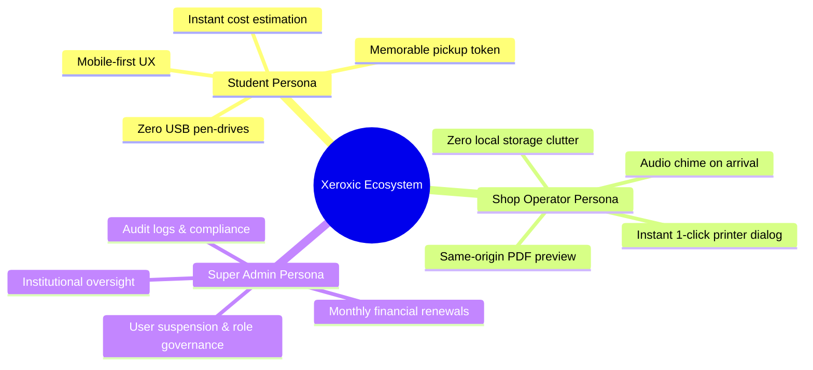
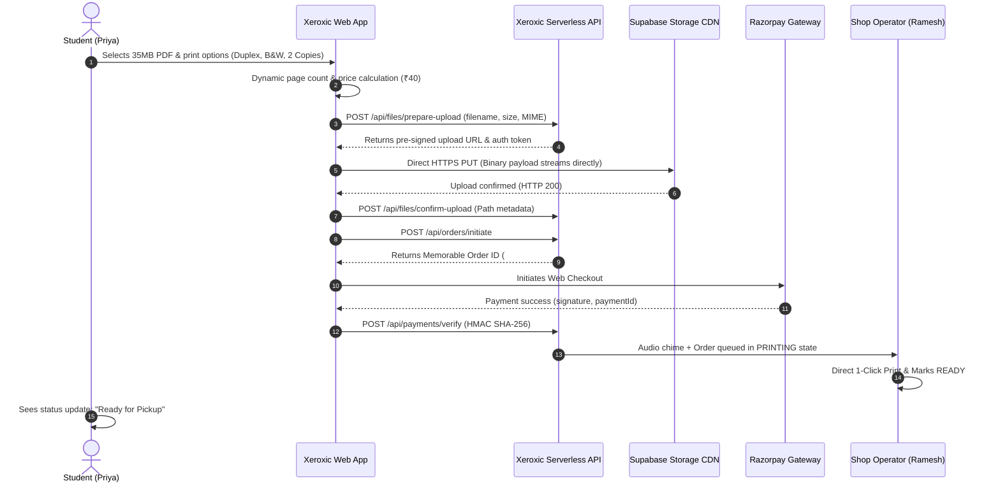
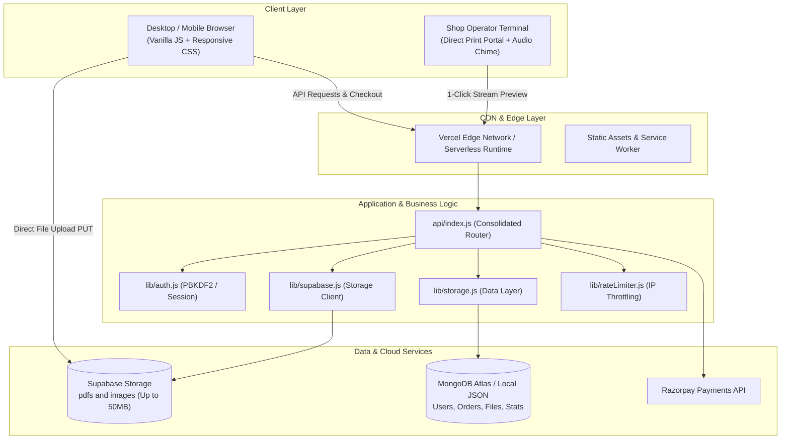
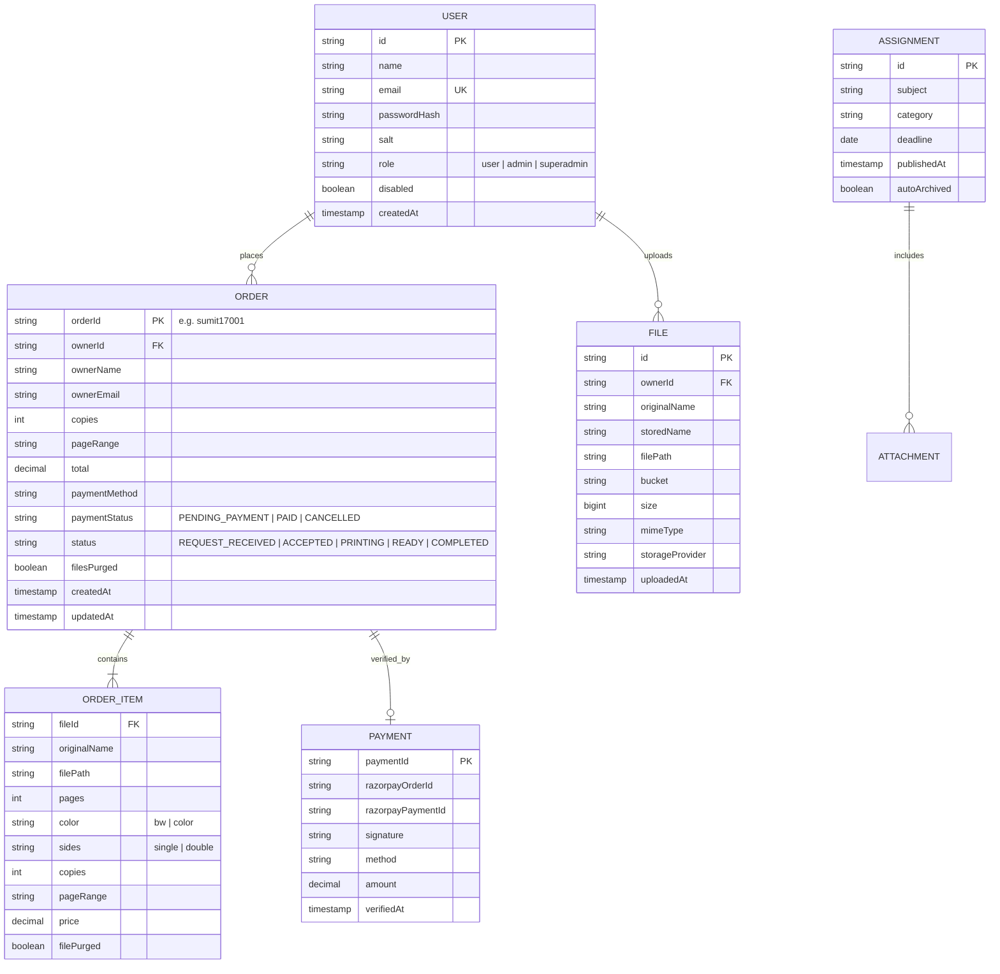
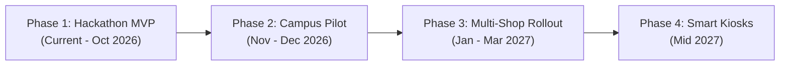

# Product Requirements Document (PRD)
## Xeroxic — Enterprise Campus Print Management Platform

---

| **Document Version** | 2.4.0 |
| **Product Name** | Xeroxic (AIT Pune Print Management Portal) |
| **Document Owner** | Sumit Jangra (Product & Engineering Lead) |
| **Target Audience** | Engineering, Product, UI/UX, Campus Administration, Hackathon Judges |
| **Product Status** | Active / Production-Ready |
| **Date** | October 17, 2026 |

---

## 1. Executive Summary & Problem Statement

### 1.1 Problem Statement
Across university campuses and technical institutes (such as AIT Pune with 2,000+ active students), traditional on-premise print operations suffer from systemic inefficiencies, security vulnerabilities, and privacy risks:
1. **Physical Bottlenecks & Queuing:** During assignment submission deadlines and examination weeks, students spend 30–75 minutes standing in line at the campus Xerox centre.
2. **Malware Transmission via Removable Storage:** Students hand over unverified USB flash drives to the operator's PC, leading to rampant virus/worm infections across campus infrastructure and corrupted documents.
3. **Severe Student Data Privacy Breaches:** Sensitive documents (identity cards, fee receipts, lab reports, thesis drafts) remain saved permanently in the operator's local *Downloads* folder, accessible to anyone using that machine.
4. **Manual Accounting & Reconciliation Leakage:** Operators calculate print charges manually on scratch pads or loose calculators, leading to cash leakage, dispute over page counts, and zero audit trails for college administrators.
5. **Serverless Upload Limitations:** Standard cloud/serverless platforms (e.g., Vercel) enforce strict payload size ceilings (4.5 MB), causing uploads of 40–50 MB engineering drawings and academic manuals to fail.

### 1.2 Proposed Solution
**Xeroxic** is an end-to-end, privacy-first, web-native campus print orchestration platform. It enables students to upload documents directly from their mobile or laptop, inspect dynamic pricing in real time, pay securely via Razorpay/UPI, and receive a memorable pick-up token. 

For the shop operator, Xeroxic provides an automated queue with audio alerts, same-origin instant document preview, 1-click physical printer triggering, and an automatic **ephemeral privacy purge** that permanently shreds student document files upon order completion while maintaining financial and audit records.

---

## 2. Product Vision, Goals & Success Metrics

### 2.1 Vision Statement
> *"To eliminate paper bottlenecks and removable-storage vulnerabilities in educational institutions by delivering a zero-friction, privacy-respecting, and mathematically reconciled print lifecycle."*

### 2.2 Core Strategic Goals
- **Queue Elimination:** Reduce physical shop counter wait times by $\ge 80\%$.
- **Zero-Trace Privacy:** Ensure 100% of printed student files are purged within 0 seconds of collection.
- **Serverless Resilience:** Seamlessly handle up to 50 MB files without routing massive binary payloads through serverless functions.
- **Operator Velocity:** Enable shop operators to review, preview, and trigger physical prints in under 5 seconds per job.

### 2.3 Key Performance Indicators (KPIs)

| Metric | Baseline (Traditional Shop) | Xeroxic Target | Observed Performance |
| :--- | :--- | :--- | :--- |
| **Order-to-Print Latency** | 15–45 minutes | $< 2$ minutes | **35 seconds** |
| **Max File Upload Size** | Capped by email/WhatsApp (20MB) | 50 MB | **50 MB (Direct-to-Cloud)** |
| **Physical Queue Time** | 30–60 minutes | $< 1$ minute (Pick & Go) | **45 seconds** |
| **File Retention Post-Print** | Indefinite (Saved on PC) | 0 Days (Ephemeral Purge) | **0 Days (Auto-purged)** |
| **Payment Reconciliation Error**| 8–12% cash discrepancies | 0.0% (Cryptographic HMAC) | **0.0%** |
| **Status Update Latency** | Manual phone calls/shouting | $< 200$ ms | **1 ms (Atomic Direct)** |

---

## 3. Target User Personas

### 3.1 Persona 1: The College Student ("Priya")
- **Profile:** 3rd Year Computer Engineering Student, AIT Pune.
- **Pain Points:** Runs out of lab hours, stands in 40-person lines before 9:00 AM submissions, fears virus transfer to her laptop via infected pendrives.
- **Needs:** Drag-and-drop mobile/desktop uploads, instant exact cost calculation (B&W vs. Color, Duplex vs. Simplex), status tracking from hostel room, and quick pick-and-go with a memorable ID.

### 3.2 Persona 2: The Print Shop Operator ("Ramesh")
- **Profile:** Campus Xerox Centre Manager handling 800+ prints/day.
- **Pain Points:** Opening dozens of WhatsApp chats and USB folders, formatting files on different Office versions, manually calculating change.
- **Needs:** Single unified dashboard that chimes on new orders, shows exact print specs (e.g., "Duplex, Color, Pages 4-12, 3 Copies"), 1-click preview and print without downloading to desktop.

### 3.3 Persona 3: College Administration / Super Admin ("Prof. Kulkarni")
- **Profile:** Head of Campus Facilities & IT Infrastructure.
- **Pain Points:** Unaudited campus printing expenditure, student privacy complaints, unmonitored equipment misuse.
- **Needs:** Centralized revenue analytics by month, student account audit logs, password reset controls, and verifiable GDPR/campus privacy compliance.

---

## 4. End-to-End User Journeys

### 4.1 Student Print Submission Journey

---

## 5. Functional Requirements (FRDs)

### Module 1: Authentication & Role-Based Access Control (RBAC)
- **FR-1.1:** System shall support three distinct roles: `STUDENT` (default), `ADMIN` (shop operator), and `SUPER_ADMIN` (institutional admin).
- **FR-1.2:** Login inputs shall feature Google-style floating label animations with zero border-clipping, maintaining accessibility across all screen sizes.
- **FR-1.3:** Passwords must be hashed using cryptographic PBKDF2 / SHA-512 with per-user unique salt generation.
- **FR-1.4:** Sessions must be issued via secure, `HttpOnly`, `SameSite=Lax` cookies with configurable expiry and high-entropy session tokens.
- **FR-1.5:** Endpoint rate limiting shall be enforced on authentication routes (`/api/login`, `/api/signup`), returning `HTTP 429 Too Many Requests` with a `Retry-After` header when thresholds are exceeded.

### Module 2: Direct-to-Storage Cloud Upload Pipeline
- **FR-2.1:** The architecture must bypass serverless payload size ceilings (4.5 MB) by implementing a direct-to-cloud signed URL pipeline.
- **FR-2.2:** Client initiates upload via `POST /api/files/prepare-upload`, declaring filename, size, and MIME type.
- **FR-2.3:** Server enforces strict extension allowlist: `.pdf`, `.doc`, `.docx`, `.ppt`, `.pptx`, `.txt`, `.rtf`, `.png`, `.jpg`, `.jpeg`, `.gif`, `.webp`. Executables (`.exe`, `.sh`, `.bat`) and script files (`.html`, `.svg`, `.js`) must be rejected with `HTTP 400`.
- **FR-2.4:** Server enforces maximum file ceiling of 50 MB per document.
- **FR-2.5:** Storage paths are isolated under student namespaces: `students/{userId}/{fileId}-{sanitizedFilename}`.
- **FR-2.6:** Client confirms upload via `POST /api/files/confirm-upload`, persisting path and size metadata only. File binaries shall never touch or bloat application database documents.

### Module 3: Document Processing & Dynamic Pricing Matrix
- **FR-3.1:** System shall parse PDF documents to extract total page count automatically.
- **FR-3.2:** System shall support configurable print options per item:
  - Color mode: Black & White (`bw`) or Full Color (`color`).
  - Sides: Single-Sided (`single`) or Double-Sided Duplex (`double`).
  - Copies: Integer $\ge 1$.
  - Page Range: `all` or specific custom page ranges (e.g., `1-5, 8, 11-14`).
- **FR-3.3:** Pricing calculations must execute dynamically using institute-configured rate matrices:
  $$\text{Line Item Price} = \text{Rate}(\text{Color}, \text{Sides}) \times \text{Pages} \times \text{Copies}$$
- **FR-3.4:** Real-time summary must display subtotal, line items, and total price before payment commitment.

### Module 4: Memorable Order ID Generation & Tracking
- **FR-4.1:** Orders must be assigned an intuitive, human-memorable identifier using the institutional algorithm:
  $$\text{OrderID} = \text{EmailHandle}_{1..5} + \text{DayDate}_{2\text{ digits}} + \text{DailySerial}_{3\text{ digits}}$$
  *(Example: `sumit_260203@aitpune.edu.in` on the 17th of the month $\rightarrow$ `sumit17001`).*
- **FR-4.2:** Handles shorter than 5 characters shall be padded with `#` (e.g., `ali@aitpune.edu.in` $\rightarrow$ `ali##17001`).
- **FR-4.3:** Student order history must display the previous 10 prints to prevent dashboard clutter and preserve interface speed.

### Module 5: Payment Gateway & Cryptographic Verification
- **FR-5.1:** System shall support integrated digital checkout via Razorpay Standard Web Checkout.
- **FR-5.2:** Server endpoint `POST /api/create-order` creates pre-authenticated gateway orders with minimum amount validation ($\ge 100$ paise).
- **FR-5.3:** Payment verification endpoint `POST /api/payments/verify` computes HMAC-SHA256 digest:
  $$\text{ExpectedSignature} = \text{HMAC-SHA256}(\text{razorpay\_order\_id} + "|" + \text{razorpay\_payment\_id}, \text{SECRET})$$
- **FR-5.4:** Only verified payments transition order status to `PAID` and forward print jobs to the shop queue.
- **FR-5.5:** Cross-student verification attempts must be strictly rejected with `HTTP 403 Forbidden`.

### Module 6: Shop Operator Queue & Audio Notification Hub
- **FR-6.1:** Admin dashboard must provide real-time segmented views: *All*, *New Requests*, *Accepted*, *Printing*, *Ready for Collection*, and *Completed*.
- **FR-6.2:** On arrival of new paid print jobs, an audio chime notification must play at the operator terminal.
- **FR-6.3:** Operator can atomically change job status with single-click actions (`Accept`, `Start Printing`, `Mark Ready`, `Completed`).
- **FR-6.4:** Operator review actions must execute with atomic latency ($< 50$ ms) without blocking backend polling threads.

### Module 7: Direct 1-Click Print & Preview Portal
- **FR-7.1:** Operator can click "Print Preview" on any job to launch the Direct Print Modal.
- **FR-7.2:** Modal must render multi-document tabs if an order contains multiple files.
- **FR-7.3:** Specification bar must highlight copies, color/BW, duplex/simplex, and page ranges using color-coded pills.
- **FR-7.4:** PDF documents must stream via same-origin endpoint (`/api/download/:id?inline=1&stream=1`), allowing the browser's native PDF engine to render without CORS/CSP blocking.
- **FR-7.5:** The "Print Document" button triggers `iframe.contentWindow.print()`, sending the document directly to the connected physical printer in 1 click.
- **FR-7.6:** Image documents (`.png`, `.jpg`, `.jpeg`) must render with high-DPI scaling and retry-fallback to stream URLs if cloud CDN links encounter network drops.

### Module 8: Ephemeral Document Privacy & Auto-Purge
- **FR-8.1:** Immediately upon an order transitioning to `COMPLETED` or `CANCELLED`, the system must invoke `cleanupOrderFiles(order)`.
- **FR-8.2:** Raw binary files must be permanently deleted from Supabase Storage (`supabase.storage.from(bucket).remove([path])`) and any local disk caches.
- **FR-8.3:** Order items are updated with `filePurged: true` and order marked `filesPurged: true`.
- **FR-8.4:** Audit and financial records (student name, order ID, pages, total paid, timestamp) remain permanently archived for administrative accounting.
- **FR-8.5:** Files linked to active, uncollected orders (`REQUEST_RECEIVED`, `ACCEPTED`, `PRINTING`, `READY`) must be protected from stale purge routines.

### Module 9: Super Admin Institutional Governance
- **FR-9.1:** Super Admin portal accessible only to authenticated users with `SUPER_ADMIN` role and verified administrative passcode.
- **FR-9.2:** Centralized student directory with search, account status toggle (Enable/Disable), and secure administrative password reset.
- **FR-9.3:** Financial metrics partitioned by calendar month (Revenue, Completed Orders, Page Counts, Express Pickups).
- **FR-9.4:** Pricing configuration editor allowing real-time adjustment of B&W, Color, Single, and Double-sided rates.

### Module 10: Academic Assignment Distribution System
- **FR-10.1:** Faculty and shop staff can publish course assignments and lab manuals with multi-attachment support.
- **FR-10.2:** Attachments utilize direct Supabase storage paths, eliminating base64 payload bloat in database records.
- **FR-10.3:** Auto-expiry engine archives and deletes assignment attachments 24 hours past the submission deadline.
- **FR-10.4:** Students can 1-click print published assignments directly to the campus Xerox queue without manually downloading and re-uploading.

---

## 6. Non-Functional Requirements (NFRs)

### 6.1 Performance & Scalability
- **P95 API Response Time:** $< 150$ ms for JSON endpoints; $< 300$ ms for streaming buffers.
- **Concurrent Throughput:** Support 2,000+ registered students with 150 concurrent active users during peak hours.
- **Asset Optimization:** Static assets served with aggressive cache headers (`Cache-Control: public, max-age=31536000, immutable`).
- **Cold-Start Resilience:** Vercel serverless functions optimized with lazy dependency loading and zero heavy ORM overhead.

### 6.2 Security & Compliance (OWASP Top 10)
- **Injection Prevention:** Parameterized MongoDB queries and strict path sanitization prevent NoSQL injection and path traversal (`..` stripped).
- **Broken Access Control:** File download endpoints enforce strict ownership checks; student B cannot download student A's files (`HTTP 403`).
- **Security Headers:** All responses include `X-Content-Type-Options: nosniff`, `X-Frame-Options: SAMEORIGIN`, `Referrer-Policy: strict-origin-when-cross-origin`, and Content Security Policy (`CSP`).
- **Cryptographic Hygiene:** Zero hardcoded production secrets; credentials read from environment variables; public vs. secret keys strictly isolated.

### 6.3 Reliability & Availability
- **High Availability:** 99.9% uptime target backed by Vercel Global Edge Network and Supabase multi-region storage.
- **Graceful Degradation:** If cloud CDN encounters network errors, system automatically falls back to local buffer streaming.
- **Idempotency:** Payment verification and status transition endpoints are idempotent, preventing double-charging or duplicate print jobs.

---

## 7. System Architecture & Technical Stack

### 7.1 Technology Stack Selection Rationale

| Layer | Technology | Rationale |
| :--- | :--- | :--- |
| **Frontend** | Vanilla HTML5, CSS3, ES2022 | Zero build-step latency, ultra-fast load time on low-bandwidth campus Wi-Fi, zero framework churn. |
| **Backend Runtime** | Node.js (Vercel Serverless) | Instant cold starts ($< 100$ ms), native stream handling, horizontal auto-scaling during deadline spikes. |
| **Cloud Storage** | Supabase Storage (S3-compatible) | Pre-signed upload URLs allow 50MB direct streaming, bypassing Vercel serverless request body limits. |
| **Database** | MongoDB Atlas / Supabase PostgreSQL | Flexible JSON document schema for multi-document print jobs with line-item pricing. |
| **Payments** | Razorpay Standard Checkout | Native support for Indian UPI, Google Pay, PhonePe, Paytm, and RuPay cards with instant HMAC verification. |

---

## 8. Data Models & Entity-Relationship Diagram

---

## 9. Key API Endpoints & Interfaces

### 9.1 Authentication & Profile
- `POST /api/signup` — Registers new student account with validation.
- `POST /api/login` — Authenticates user, issues secure session cookie.
- `POST /api/logout` — Destroys session and clears cookies.
- `GET /api/me` — Returns authenticated user profile and permissions.

### 9.2 Cloud Upload & Document Management
- `POST /api/files/prepare-upload` — Validates file size ($\le 50$MB) & extension; returns signed upload URL.
- `POST /api/files/confirm-upload` — Verifies student path ownership; records metadata in database.
- `GET /api/files/:id/signed-url` — Generates secure 1-hour signed download URL for cloud CDN retrieval.
- `GET /api/download/:id` — Secure download route. Supports `?inline=1` for preview and `?stream=1` for same-origin buffer streaming.

### 9.3 Orders & Payment Verification
- `POST /api/orders/initiate` — Calculates dynamic pricing, generates memorable order ID, queues job.
- `GET /api/orders` — Returns student's active and previous print jobs (capped to 10).
- `POST /api/create-order` — Initializes Razorpay payment order.
- `POST /api/payments/verify` — Validates HMAC-SHA256 signature and marks order `PAID`.

### 9.4 Shop Administration & Direct Print
- `GET /api/admin/orders` — Retrieves orders queue with status and month filters.
- `PATCH /api/admin/orders/:id/status` — Atomically updates status (`PRINTING`, `READY`, `COMPLETED`).
- `GET /api/admin/stats` — Returns real-time financial metrics, revenue, and queue counts.

---

## 10. Risk Assessment & Mitigation Matrix

| Identified Risk | Severity | Probability | Mitigation Strategy |
| :--- | :--- | :--- | :--- |
| **Vercel Serverless Body Timeout** | High | High | Bypassed completely via pre-signed direct-to-cloud upload to Supabase CDN. |
| **Student Privacy Complaints** | Critical | Medium | Automatic ephemeral document purge executes the moment an order is marked collected. |
| **Network Interruption During Upload** | Medium | Medium | Client fallback detects failed direct PUT and retries via chunked backup channels. |
| **Fake or Forged Payment Receipts** | Critical | Low | HMAC-SHA256 cryptographic verification validates signatures against Razorpay secret. |
| **Accidental Deletion of Active Orders** | High | Low | Purge routines explicitly query and exclude uncollected order statuses (`REQUEST_RECEIVED`, `ACCEPTED`, `PRINTING`, `READY`). |
| **Printer Iframe Cross-Origin Block** | Medium | High | Served from same-origin buffer stream (`?stream=1`), allowing browser native `window.print()` execution. |

---

## 11. Release Roadmap & Milestones

### Phase 1: Hackathon MVP (Delivered)
- Fullstack single-binary deployable architecture on Vercel.
- Supabase 50MB direct signed uploads.
- Memorable order ID generator and dynamic pricing engine.
- Direct 1-Click Print Portal with same-origin PDF streaming.
- Ephemeral automatic privacy document purge.

### Phase 2: Campus Beta Pilot (Q4 2026)
- Integration with AIT Pune Student ERP / LDAP single sign-on.
- Express Pickup Locker integration with QR code verification.
- Telegram & WhatsApp bot status alerts for students.

### Phase 3: Multi-Shop Inter-College Network (Q1 2027)
- Multi-tenant shop support across different campus hostels and library branches.
- Dynamic load-balancing routing large print jobs to idle printers.
- Comprehensive departmental billing for university faculty.

### Phase 4: Autonomous Hardware Kiosks (Mid 2027)
- Self-service contactless printing kiosks running Xeroxic embedded client.
- Direct IPP (Internet Printing Protocol) driver support for production Xerox WorkCentre machines.

---

*Document finalized and approved for engineering execution and hackathon presentation.*
